 

## ✦ &nbsp;About me

I'm a **BSc (Hons) Computer Science** undergraduate at **NSBM Green University**, Sri Lanka, and a full-stack developer
who enjoys taking products from first idea to live deployment.

- 🎯 **Focus areas** — full-stack development · AI agents & LLM · machine learning
- 📚 **Currently strengthening** — system design · automated testing · CI/CD
- 🔬 **Up next** — final-year research in NLP for low-resource languages
- 💼 **Open to** — software engineering, data or ML internships (on-site or hybrid)

## ✦ &nbsp;Featured work

<table>
  <tr>
    <td width="50%">
      
      
<a href="https://talentbridge-application-tracking-system.vercel.app">Live demo</a> · <a href="https://github.com/KasundiRanaweera/Application_Tracking_System-Backend">Backend</a> · <a href="https://github.com/KasundiRanaweera/Application_Tracking_System-Frontend">Frontend</a> · <a href="https://application-tracking-system-backend.onrender.com/swagger-ui.html">API docs</a>

    </td>
    <td width="50%">
      
      
<a href="https://flower-shop-kasundi.vercel.app">Live demo</a> · <a href="https://github.com/KasundiRanaweera/Flower_Shop">Source</a>

    </td>
  </tr>
  <tr>
    <td width="50%">
      
      
<a href="https://github.com/KasundiRanaweera/Hotel_Management_AI_Agent">Source</a>

    </td>
    <td width="50%">
      
      
<a href="https://github.com/KasundiRanaweera/GoodDeeds-Main-App">Source</a>

    </td>
  </tr>
</table>

<!-- LATEST-PROJECTS:START -->
<table>
  <tr>
    <td width="50%">
      
      
<a href="https://github.com/KasundiRanaweera/My_LLM_Learning_Projects">Source</a>

    </td>
    <td width="50%">
      
      
<a href="https://github.com/KasundiRanaweera/My_First_AI_Agent">Source</a>

    </td>
  </tr>
  <tr>
    <td width="50%">
      
      
<a href="https://github.com/KasundiRanaweera/Regression_ml_project">Source</a>

    </td>
    <td width="50%">
      
      
<a href="https://github.com/KasundiRanaweera/weather_app">Source</a>

    </td>
  </tr>
</table>
<!-- LATEST-PROJECTS:END -->

<!-- MORE-PROJECTS:START -->

<b>&nbsp;🔹 More things I've built</b>

 

| | Project | What it is | Stack |
|:-:|---|---|---|
| 🙈 | [PAS — Blind Matching](https://github.com/KasundiRanaweera/Project-Approval-System) | Matches student research proposals with supervisors while hiding student identities until a match is confirmed, to reduce bias. | ASP.NET Core · C# · EF Core · SQL Server |
| 🚌 | [Campus Shuttle Service](https://github.com/KasundiRanaweera/University-Shuttle-Service-) | University shuttle system with live maps and payments, backed by full design docs — use-case, class and EER diagrams plus sprint planning. | React · TypeScript · Supabase · Leaflet · Cypress |
| 🎓 | [Student Management App](https://github.com/KasundiRanaweera/student_management_app) | Flutter mobile app with full create, read, update and delete for student records in Firebase Firestore. | Flutter · Dart · Firestore |

<!-- MORE-PROJECTS:END -->

## ✦ &nbsp;Tech stack

## ✦ &nbsp;On GitHub

<picture>
  <source media="(prefers-color-scheme: dark)" srcset="https://raw.githubusercontent.com/KasundiRanaweera/KasundiRanaweera/output/snake-dark.svg"/>
  <source media="(prefers-color-scheme: light)" srcset="https://raw.githubusercontent.com/KasundiRanaweera/KasundiRanaweera/output/snake-light.svg"/>
  
</picture>

## ✦ &nbsp;Let's build something

I'm looking for an **internship in software engineering, data or ML** — on-site or hybrid.
If you're working on something where a curious, ship-it-end-to-end developer would help, I'd love to hear about it.

  
  

